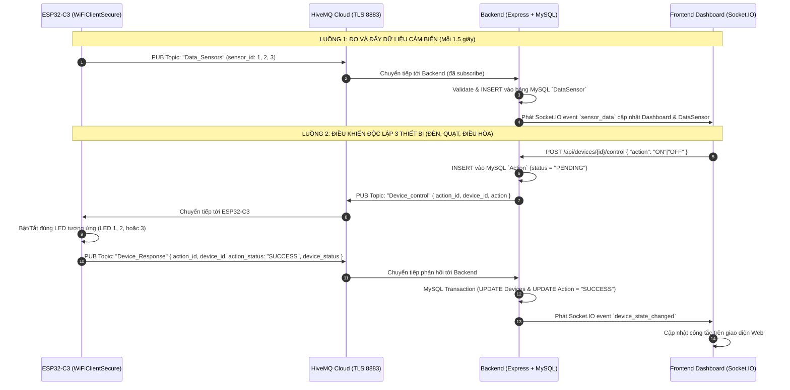

# Firmware ESP32-C3 - IoT Smart Classroom (Bài 2.2)

> **Mã sinh viên:** B23DCAT196  
> **Dự án:** Hệ thống Quản trị & Điều khiển Lớp học Thông minh (IoT Smart Classroom)  
> **Board mạch:** WEMOS LOLIN C3 Mini (ESP32-C3 RISC-V Architecture)  
> **Framework:** Arduino Core trên PlatformIO  
> **MQTT Broker:** **HiveMQ Cloud Serverless (TLS Port 8883)**  

---

## 1. Danh sách Phần cứng Thực tế & Sơ đồ nối chân GPIO

### A. Cảm biến Môi trường
| Cảm biến | Chức năng | Chân trên Module | Chân GPIO trên ESP32-C3 | Ghi chú kỹ thuật |
| :--- | :--- | :---: | :---: | :--- |
| **DHT11** | Đo Nhiệt độ & Độ ẩm | DATA (OUT) | **GPIO 0** | Kéo trở Pull-up 10kΩ nếu module chưa tích hợp |
| **BH1750** | Đo Cường độ Ánh sáng (Lux) | SDA | **GPIO 8** | Chuẩn giao tiếp I2C, địa chỉ `0x23` |
| **BH1750** | Đo Cường độ Ánh sáng (Lux) | SCL | **GPIO 9** | Chuẩn giao tiếp I2C |

### B. Cơ cấu Chấp hành (3 LED rời mô phỏng thiết bị)
> [!IMPORTANT]
> **LƯU Ý:** 3 LED 5mm dưới đây là **LED mô phỏng cơ cấu chấp hành cho thiết bị** trong mô hình thí nghiệm lớp học thông minh. Không mô tả LED là quạt hoặc điều hòa thật.

| Cơ cấu Chấp hành | Thiết bị Mô phỏng | Mã Thiết bị (`device_id`) | Chân GPIO ESP32-C3 | Điện trở hạn dòng |
| :--- | :--- | :---: | :---: | :--- |
| **LED 1** (Đỏ / Vàng) | **Đèn Chiếu sáng** | `device_id = 1` | **GPIO 3** | **BẮT BUỘC 220Ω – 330Ω riêng** |
| **LED 2** (Xanh lá) | **Quạt Thông gió** | `device_id = 2` | **GPIO 1** | **BẮT BUỘC 220Ω – 330Ω riêng** |
| **LED 3** (Xanh dương) | **Điều hòa Không khí** | `device_id = 3` | **GPIO 10** | **BẮT BUỘC 220Ω – 330Ω riêng** |

> [!CAUTION]
> **QUY TẮC AN TOÀN ĐIỆN BẮT BUỘC:**
> 1. Mỗi LED 5mm (điện áp 1.8V – 3.0V, dòng định mức 10 – 15mA) **BẮT BUỘC phải mắc nối tiếp một điện trở hạn dòng riêng** (giá trị khuyến nghị $220\Omega$ đến $330\Omega$) nối giữa chân GPIO và chân Anode (+) của LED. Chân Cathode (-) nối về điểm mass GND chung.
> 2. **Tuyệt đối không dùng chung một điện trở cho cả 3 LED** (sẽ gây sụt áp, độ sáng không đều và nguy cơ quá tải chân vi điều khiển).
> 3. **Tuyệt đối không nối trực tiếp LED vào GPIO mà không có điện trở hạn dòng** (dễ làm cháy LED hoặc hỏng cổng xuất của vi điều khiển ESP32-C3).

---

## 2. Kiến trúc Hệ thống & Luồng Dữ liệu MQTT Cloud

Hệ thống kết nối trực tiếp lên **HiveMQ Cloud Serverless qua kết nối bảo mật TLS (Port 8883)** và tuân thủ nghiêm ngặt **CHỈ ĐÚNG 3 MQTT TOPIC**:



---

## 3. Cấu trúc Thư mục Firmware

```
hardware/esp32/
├── platformio.ini         # Cấu hình PlatformIO cho board LOLIN C3 Mini (USB CDC)
├── include/
│   ├── hivemq_ca.h        # Chứng chỉ gốc Let's Encrypt ISRG Root X1 & Root YR CA
│   └── config.h           # File cấu hình Wi-Fi, HiveMQ Host, Port, chân GPIO
├── src/
│   └── main.cpp           # Mã nguồn firmware C++ Arduino điều khiển độc lập 3 LED
├── .gitignore             # Bỏ qua file build .pio/ và config.h chứa mật khẩu
└── README.md              # Tài liệu hướng dẫn chi tiết
```

---

## 4. Bảng Tra cứu Mã Thiết bị & Chân GPIO

| `device_id` | Tên Thiết bị | Cơ cấu chấp hành | Chân GPIO | Trạng thái ban đầu | Trạng thái điều khiển |
| :---: | :--- | :--- | :---: | :---: | :---: |
| **1** | **Đèn** | LED 1 | **GPIO 3** | `OFF` (LOW) | `ON` (HIGH) / `OFF` (LOW) |
| **2** | **Quạt** | LED 2 | **GPIO 1** | `OFF` (LOW) | `ON` (HIGH) / `OFF` (LOW) |
| **3** | **Điều hòa** | LED 3 | **GPIO 10** | `OFF` (LOW) | `ON` (HIGH) / `OFF` (LOW) |

- **Bật thiết bị nào:** Chỉ LED tương ứng với thiết bị đó sáng.
- **Bật nhiều thiết bị:** Các LED tương ứng cùng sáng độc lập.
- **Tắt thiết bị nào:** Tắt đúng LED của thiết bị đó, các LED khác giữ nguyên trạng thái.

---

## 5. Hướng dẫn Biên dịch, Nạp Code & Theo dõi Serial

### Biên dịch Firmware (Build)
```powershell
& "$env:USERPROFILE\.platformio\penv\Scripts\pio.exe" run
```

### Nạp Code vào Bo mạch qua USB (Upload)
```powershell
& "$env:USERPROFILE\.platformio\penv\Scripts\pio.exe" run -t upload --upload-port COM3
```

### Mở Serial Monitor theo dõi log (115200 baud)
```powershell
& "$env:USERPROFILE\.platformio\penv\Scripts\pio.exe" device monitor -p COM3 -b 115200
```

#### Log Serial Monitor chuẩn khi nhận lệnh điều khiển:
```text
----------------------------------------------------
📥 [MQTT Nhận Lệnh]
   action_id=1001
   device_id=1
   action=ON
💡 [Hardware LED]
   Thiết bị Đèn (ID: 1) -> LED 1 -> BẬT (ON)
📤 [MQTT Device_Response]
   action_status=SUCCESS
   device_status=ON
   payload={"action_id":1001,"device_id":1,"action_status":"SUCCESS","device_status":"ON"}
----------------------------------------------------

----------------------------------------------------
📥 [MQTT Nhận Lệnh]
   action_id=1002
   device_id=2
   action=ON
💡 [Hardware LED]
   Thiết bị Quạt (ID: 2) -> LED 2 -> BẬT (ON)
📤 [MQTT Device_Response]
   action_status=SUCCESS
   device_status=ON
   payload={"action_id":1002,"device_id":2,"action_status":"SUCCESS","device_status":"ON"}
----------------------------------------------------

----------------------------------------------------
📥 [MQTT Nhận Lệnh]
   action_id=1003
   device_id=3
   action=ON
💡 [Hardware LED]
   Thiết bị Điều hòa (ID: 3) -> LED 3 -> BẬT (ON)
📤 [MQTT Device_Response]
   action_status=SUCCESS
   device_status=ON
   payload={"action_id":1003,"device_id":3,"action_status":"SUCCESS","device_status":"ON"}
----------------------------------------------------
```

---

## 6. Định dạng Payload trên 3 Topic Chuẩn

### Topic 1: `Data_Sensors` (ESP32 $\rightarrow$ HiveMQ Cloud $\rightarrow$ Backend)
- **Nhiệt độ (Sensor ID 1):** `{"sensor_id": 1, "value": 29.5}`
- **Độ ẩm (Sensor ID 2):** `{"sensor_id": 2, "value": 65.0}`
- **Ánh sáng (Sensor ID 3):** `{"sensor_id": 3, "value": 420.0}`

### Topic 2: `Device_control` (Backend $\rightarrow$ HiveMQ Cloud $\rightarrow$ ESP32)
- **Bật/Tắt Đèn (ID 1):** `{"action_id": 1001, "device_id": 1, "action": "ON"|"OFF"}`
- **Bật/Tắt Quạt (ID 2):** `{"action_id": 1002, "device_id": 2, "action": "ON"|"OFF"}`
- **Bật/Tắt Điều hòa (ID 3):** `{"action_id": 1003, "device_id": 3, "action": "ON"|"OFF"}`

### Topic 3: `Device_Response` (ESP32 $\rightarrow$ HiveMQ Cloud $\rightarrow$ Backend)
- **Phản hồi Thành công (SUCCESS):**
  ```json
  {"action_id": 1001, "device_id": 1, "action_status": "SUCCESS", "device_status": "ON"}
  ```
- **Phản hồi Thất bại (FAIL - Chỉ khi payload không hợp lệ hoặc sai device_id):**
  ```json
  {"action_id": 1001, "device_id": 99, "action_status": "FAIL"}
  ```
